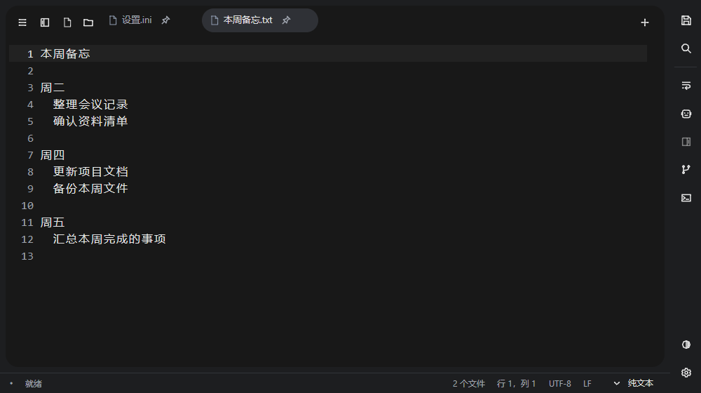

<div align="center">
  <picture>
    <source media="(prefers-color-scheme: light)" srcset="internal/editor/assets/icon-light.png">
    
  </picture>
  <h1>EditorX</h1>
  <p>基于 Go 和 Viva 的 Windows 文本编辑器，支持文本、配置、日志和常用文档格式。</p>
  <p><a href="https://github.com/Yuands9/editorx/releases/latest/download/EditorX.exe"><strong>下载 EditorX.exe</strong></a> · Windows x64</p>
  <p>下载后双击运行，把文件拖进窗口即可打开。有新版时侧栏会提示，也可在「设置 → 关于」手动检查。</p>
</div>



## 主要功能

- 多标签和分屏编辑，支持多光标、列选择、目录查找替换、编码与换行转换、大文件浏览和日志跟随。
- Ctrl+P 快速打开文件，Ctrl+Shift+P 打开命令面板。可切换 EditorX、VS Code、IntelliJ IDEA、PyCharm、Notepad++、Sublime Text 和 EditPlus 快捷键预设，也可逐项搜索和自定义。
- 应用界面支持简体中文和英文，可在「设置 → 外观 → 界面语言」即时切换。输入时自动补全默认开启，可在编辑器设置中关闭。
- 格式化和对比 JSON，预览 Markdown、HTML、PDF、Word 和图片，编辑 Excel 工作簿。
- 项目树支持 Git 右键操作，提交侧栏可按文件勾选并用 AI 生成说明，提交记录可以在独立窗口查看。也支持本地终端、本地历史与差异合并、模板、加密密码本、宏、自定义工具和 AI 翻译。

## 技术栈

| 层级 | 技术 | 用途 |
| --- | --- | --- |
| 桌面界面 | Go 1.26、Viva v0.6.6 | Windows 原生窗口、菜单、编辑区、焦点与输入法、Markdown 渲染和差异视图 |
| 文本与图像处理 | Go 标准库、golang.org/x/text、golang.org/x/image | 文本和结构化数据处理、旧编码转换、图像解码 |
| 文档预览与编辑 | WebView2、Univer、Excelize、PDF.js、SuperDoc | 内嵌 HTML、Office 和 PDF 界面。Univer 和 Excelize 处理 Excel，PDF.js 渲染 PDF。公开版提供 Word 只读预览，本地构建可用 SuperDoc 编辑 DOCX |
| 项目工具 | Git、Windows ConPTY、PowerShell、xterm.js | 调用本机 Git，运行本地终端并呈现终端界面 |
| 可选离线组件 | 嵌入式 Python、Argos 模型、CTranslate2、Tesseract | 按需安装，用于中英离线翻译和图片文字识别 |
| 构建 | PowerShell 7、Node.js、npm、esbuild | 构建和打包 Windows EXE，按锁定依赖生成内嵌的前端资源 |

Viva 是 Go 原生桌面应用框架。EditorX 在仓库中固定了 Viva 版本，并保留了 Windows 窗口、输入和渲染相关的补丁。[Viva 项目](https://github.com/vivaui/viva) · [EditorX 的 Viva 补丁](patches)

## 从源码构建

在 Windows 上安装 Go 1.26、Node.js 和 PowerShell 7，在仓库根目录执行下面的命令。

```powershell
.\dev.ps1 -Action build -PublicRelease
.\dev.ps1 -Action test -PublicRelease
```

构建产物为 `dist/EditorX.exe`。本地 Word 编辑构建及第三方组件许可见 [设计与发布说明](docs/design.md#发布范围)。

[使用指南](docs/usage.md) · [功能清单](docs/features.md) · [测试用例](docs/test-cases.md) · [问题反馈](https://github.com/Yuands9/editorx/issues) · [Apache-2.0 许可证](LICENSE)
