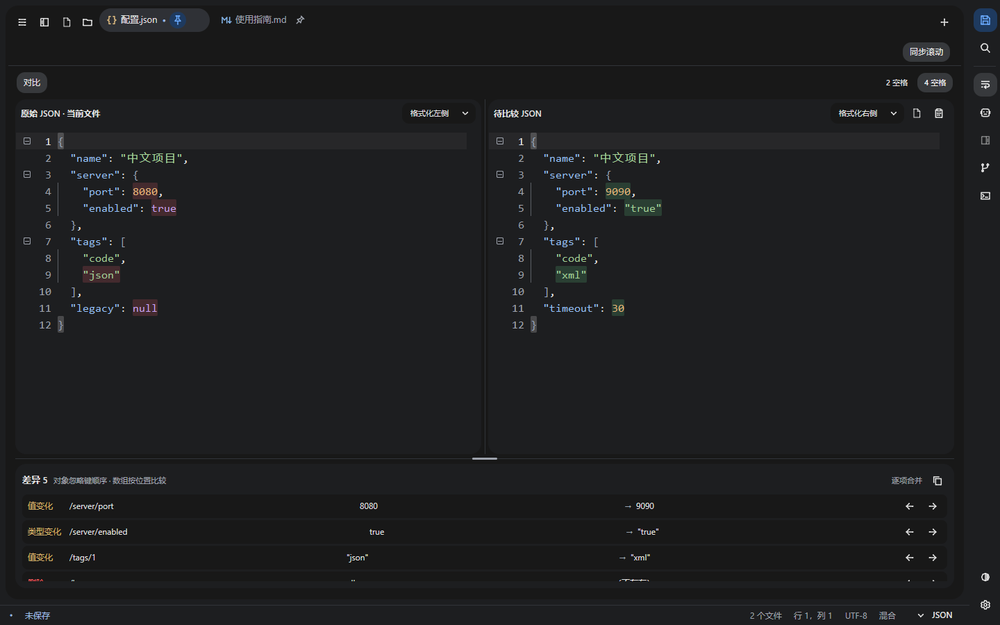
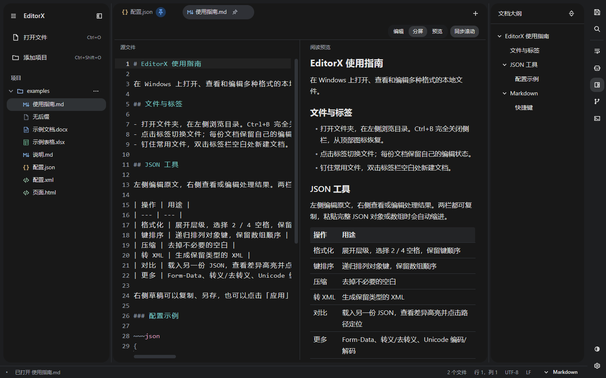

<div align="center">
  
  <h1>EditorX</h1>
  <p><strong>Windows 多格式文本编辑器</strong></p>
  <p>打开本地文本和配置，整理 JSON，查看文档与图片。</p>
  <p>
    <a href="https://github.com/Yuands9/editorx/releases/latest/download/EditorX-windows-x64.zip"><strong>↓ 下载 Windows x64 便携版</strong></a>
    · <a href="https://github.com/Yuands9/editorx/releases/latest/download/EditorX.exe">单文件 EXE</a>
    · <a href="https://github.com/Yuands9/editorx/releases/latest">发布说明</a>
    · <a href="docs/usage.md">使用指南</a>
  </p>
</div>

## 三步上手

1. 下载便携版 ZIP，解压到有写入权限的目录。
2. 双击 `EditorX.exe`。把文件从资源管理器拖进窗口，或按 `Ctrl+O` 选择文件。
3. 用 `Ctrl+F` 查找、`Ctrl+R` 替换，按 `Ctrl+S` 保存。想先试用，可以打开仓库的[示例文件](examples)。

会话和设置保存在 EXE 旁的 `data` 目录。Excel、PDF、HTML 内嵌预览及终端使用 [Microsoft Edge WebView2 Runtime](https://developer.microsoft.com/microsoft-edge/webview2/#download-section)。

<p align="center">
  
</p>

## 功能一览

| 场景 | 可以做什么 |
| --- | --- |
| 编辑本地文件 | 处理 UTF-8 文本、无后缀文件、XML、YAML、INI、TOML、`.properties` 和 `.env`，支持中文输入、语法高亮及跨标签多行查找替换 |
| 处理 JSON | 双栏同步编辑、自动格式化、压缩、折叠、键排序、结构对比和逐项合并，支持转义转换及导出 XML、Form-Data |
| 查看与编辑文档 | Markdown 和 HTML 可分屏预览，PDF 可按标题或书签跳转，支持编辑 Excel `.xlsx`、查看图片和 XMind |
| 管理工作区 | 标签可拖动、分组、固定和重命名，支持添加多个项目文件夹、恢复会话、托盘和跟随 Windows 主题 |
| 按需使用工具 | 内置 Git 和 PowerShell 入口，可配置 AI 助手使用 API 或已登录的本机 CLI |

<details>
  <summary>查看 Markdown 分屏与大纲截图</summary>
  <p></p>
</details>

## 常用快捷键

| 操作 | 快捷键 |
| --- | --- |
| 打开文件 / 添加项目文件夹 | `Ctrl+O` / `Ctrl+Shift+O` |
| 新建标签 / 关闭当前标签 | `Ctrl+N` / `Ctrl+W` |
| 查找 / 替换 | `Ctrl+F` / `Ctrl+R` |
| 保存 / 另存 | `Ctrl+S` / `Ctrl+Shift+S` |
| 显示或隐藏项目栏 / 打开设置 | `Ctrl+B` / `Ctrl+,` |

## 文档与反馈

- [使用指南](docs/usage.md) · [完整功能](docs/features.md) · [设计与发布](docs/design.md) · [大文件首次打开实测](docs/large-files.md)
- [提交问题或建议](https://github.com/Yuands9/editorx/issues)

## 从源码构建

准备 Windows、Go 1.26、Node.js 24 或更新版本和 PowerShell 7。在仓库目录里执行：

```powershell
.\dev.ps1 build -PublicRelease
.\dist\EditorX.exe
.\dev.ps1 test -PublicRelease
```

生成的文件位于 `dist`，开发缓存位于 `.dev`。公开下载版使用上述构建方式。源码中的 Word 编辑组件另有依赖许可，见[发布说明](docs/design.md#发布范围)。

EditorX 基于 [Viva](https://github.com/vivaui/viva)，自有源码采用 [Apache-2.0](LICENSE)。便携版附带第三方许可声明。
